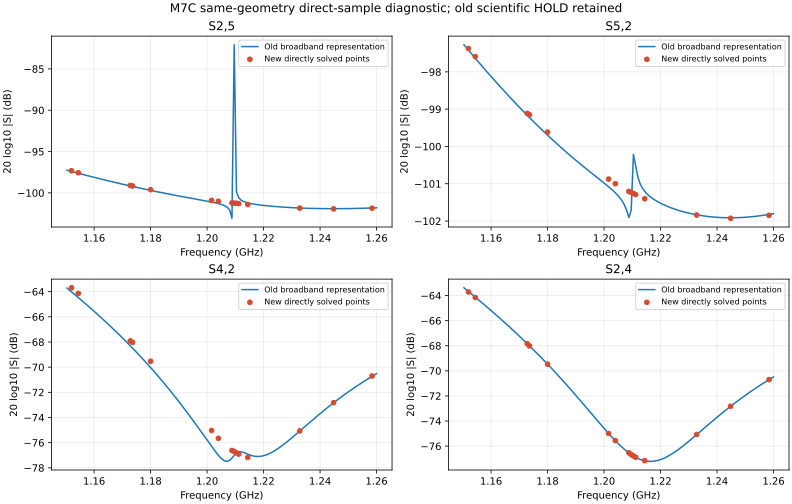

# M7C 直接频点诊断结果 — 2026-10-27

阶段结论：**H_NUM_SUPPORTED_M7C_DIRECT_SAMPLE**。本阶段已回答预登记问题并关闭；原科学状态继续保持 **HOLD_M7C_GUARD**。

大白话：旧曲线里最显眼的尖峰，在相同结构的直接频点解中没有复现。现在正反方向都约为 −101.2 dB，基本对齐。这支持“旧宽带表示在极弱响应处不可靠”的解释。**两条信号支路不对称的问题并没有因此解决。**

## 1. 执行与授权

用户明确授权 Codex 自主规划并决定本阶段需要的 BUILD/SOLVE。代理选择不重建几何，只执行一次相同 M7C 模型的直接频点诊断。

- qualification source：`d8fdb3f17a8084c910be41701f6c01e9f91181f4`。
- authorization checkout：`ad87419240e7774a4bc80b42ae689a62ae894afd`。
- grant：`GNSS-M7C-DIRECT-SAMPLE-SOLVE-GRANT-20261027-01`，已 CONSUMED/关闭。
- packet：`GNSS-M7C-DIRECT-SAMPLE-20261027-V01`。
- formal invocation：1；geometry BUILD：0；自动重试：0。
- 运行事务：北京时间 10:23:47–10:35:09；实际 solver 调用耗时 614.187 s。
- 首次确认进入 solver_run 后，被动等待现有连接完成，没有持续远端运行轮询。

几何、材料、12-port/8-source/4-load 语义、边界、二阶 tetra、MaxDeltaS=0.02×2、MaxPasses=16、线性求解精度保持冻结。唯一执行变化是 `Discrete samples only` 与预登记频点列表。

## 2. 预登记问题的判定

问题：1.2096 GHz 的 S2,5 峰值能否在直接频点解中以互易方式复现？

| 1.2096 GHz | 旧宽带表示 | 新直接频点 |
| --- | --- | --- |
| S2,5 幅度 | −82.083645 dB | **−101.238764 dB** |
| S5,2 幅度 | −101.721018 dB | **−101.229672 dB** |
| S2,5 线性幅度 | 7.867156e-5 | 8.670853e-6 |

冻结的三个 H_NUM 支持条件全部成立：

1. 全部 15 点的 S2,5/S5,2 最大复数互易差 **8.567101e-8**，低于 1e-6 分辨预算。
2. 原峰值频率的新旧正向复数差 **7.094540e-5**，超过预登记的 1e-5。
3. 1.2088/1.2096/1.2104/1.2112 GHz 四个邻点的两个方向均不超过旧峰值的 0.5 倍。

因此按结果之前已经冻结的规则判为 **H_NUM_SUPPORTED_M7C_DIRECT_SAMPLE**。这支持旧峰值的宽带表示/弱响应精度解释；不将其扩大为“全部 Guard 失败都是假象”或“整个模型没有数值/物理误差”。

## 3. 数据和数值资格

- 全部 96 条必需响应，15 个诊断频点，**1440 个复数响应值**完整。
- 原生结果网格为 16 点：上述 15 点加 1.8-GHz adaptation 点；没有用 1001 点宽带曲线重采样冒充直接解。
- 原生日志对每个诊断频率明确记录 `Sample N of 16`，并逐项列出全部八个激励。
- 八个激励的原生残差曲线均包含所有诊断频率；保留原生绘图纵坐标，不把其未转换值解释为 EM 误差上界。
- native adaptation 共 4 passes；DeltaS 序列 0.07268、0.0154016、0.0149358；最后两次均 ≤0.02。
- 15 个诊断点的 source-side 最大复数互易差 1.321895e-5（冻结限值 0.02）。
- 15 个诊断点的 loaded-power 上界最大 0.9999761373（冻结上限 1.02）；不扩大为独立功率分区/损耗闭合证明。
- 无 fatal/mesh-corruption 触发；源/端口/几何签名与只读前后哈希检查通过。

最终只读资格的 **11 项检查全部通过**。旧 Sdc/Sdd/Guard 阈值、生产 evaluator 与预登记诊断标准均未修改。

## 4. 其余 Guard 与支路不对称仍要保留

S4,2/S2,4 的直接点仍跟随旧曲线的低频宽起伏。各取原失败窗口内的六个已计算点：

- S4,2：1.1544–1.2040 GHz，直接点峰谷差 11.516724 dB。
- S2,4：1.1520–1.2016 GHz，直接点峰谷差 11.273534 dB。

这是稀疏直接点的上下文结果，不是重新执行全带冻结 Guard 的替代数据；它明确说明不能通过最严重尖峰消失就忽略其余驱动。

在新增的 15 个低频点，独立模态上下文显示：

| 相对 isolated baseline 的 Sdc 变化幅度 | Pol-A | Pol-B |
| --- | --- | --- |
| 新直接点范围 | 0.101852–0.117556 | 0.299978–0.396154 |
| 与旧 M7C 对应点的最大复数差 | 2.835175e-6 | 9.112453e-5 |

这与原来“宽带支路自反射不对称仍在”的结论一致。此 15 点上下文没有替代原来的十项锚点对称性 gate；原 Sdc 0/10、Sdd 6/6 及 HOLD_M7C_GUARD 继续保留。

## 5. 工程失败与零求解恢复历史

原正式 runner 结果保持 **HOLD_ENTRYPOINT**，不改写成 PASS。solver 已完成，失败发生在 post-processing：

1. 离散反射曲线的 `get_data()` 每行有频率、复数 S、复数 Zref 三项；原读取器按两项解包。这是读取兼容性漏项。V01 只读恢复改用独立 x/y 访问器，固定 solved SHA 前后相同。
2. 原宽带日志解析器不识别离散模式的 `Sample N of 16`，V01 因来源检查保守 HOLD。CPU-only V02 从精确保留的原始 native bytes 逐点验证 15 个频率及全部 8 个激励，不重算任何响应。
3. Windows 渲染文本可发生换行转换，因此 V02 以 base64 保存的 solver 原字节为 authority，不以渲染文本副本作 byte identity。

原 runner HOLD、异常、V01 HOLD 与 V02 合格结果分别保存。全部恢复新增 solver/application 调用为 **0/0**。这不是为了让 runner 显示 PASS 而重跑求解。

## 6. 保护与身份

| 对象 | SHA256 / identity |
| --- | --- |
| reviewed BUILD | ee25237bc5f70e457adadf3745faf3d64f1401bb47717da5322d7347ba50ce98 |
| new solved `.cst` | c21fa9f047d83f4f3776d5e6ef5718e8924aaf8e54f0ad8cbb7cb6a7c6681851；154176 bytes |
| complete solved companion | 59f363732e407cec1eb1f9fa62d25bc6778dccb11e40315dabaaea50482b5803；849 files；19,799,723,618 bytes；SIMOPS_TREE_ID_V1 |
| direct CSV | 5a05b7ff07c66ded612c58dca4f3ae82e55ce290a4812c0518ab8edb5027c793 |
| global execution identity | 99ec026ab8ab4847688016bf5d0c031c9ffd113923ce58430153705f0d9355a1；FINALIZED |

完整结果仍保护于：

`C:\GNSS_Lband_Active_Array\runs\formal\solver_runs\M7C_DIRECT_SAMPLE_20261027_V01`

最终 C: 可用空间 106,120,454,144 bytes；无残留本次 simulator process。源 BUILD/companion、旧 M7C solved、E2C/isolated 基线及全部冻结生产依赖后验检查通过。无旧结果清理/迁移。C: 仍是项目执行/保护位置，不宣称已成为合格长期存储。

## 7. 阶段关闭与回流结构决策

**当前不改 moat、不重建、不追加求解。** 这次诊断排除了按那个单向尖峰直接修改铜皮的依据；它没有提供足够电流/局部参考势证据来指定某一段回流几何的改法。

M7C 保留为“恢复部分差模自加载、但没有达到对称性要求”的受保护诊断模型，不提升为合格拓扑。下一物理设计关应针对两支路的局部参考/回流环境差异，先做连接/参考面与耦合路径的单假设冻结，再决定唯一几何变量；不能从本诊断直接开始 moat 宽度 sweep。

本长任务完成：授权已消费并关闭，BUILD/SOLVE=false，active_grant=null；没有自动开启后续物理阶段。完整证据见 `evidence/M7C_DIRECT_SAMPLE_RESULT_20261027_V01/`。
