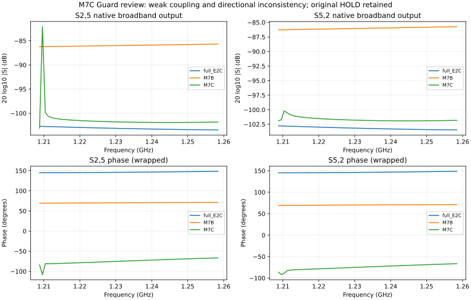
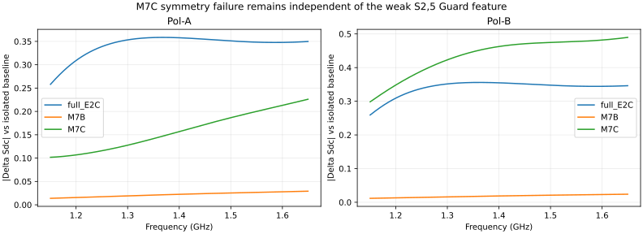

# M7C 离线归因评审 — 2026-10-27

评审完成；物理因果仍有未决项。科学状态保持 **HOLD_M7C_GUARD**。

本轮仅通过直接 SSH/SFTP 读取 NW 已有文件，在本地做静态审计和复数曲线分析。没有启动 CST 应用，没有 BUILD、SOLVE、几何修改、清理或迁移；没有修改任何冻结阈值或生产 evaluator。

## 1. 结论与下一步

M7C 同时存在两个需要分别解释的现象：

1. 最严重 Guard 特征处于极弱耦合量级，正反向响应不一致，且峰值不是直接求解频点。**局部宽带近似/数值误差是待验证假设，不能据此宣布物理共振，也不能豁免 Guard。**
2. 两种极化的 Sdc 失败是宽带、较大量级的自反射不对称变化。它不能由这个约 7e-5 的弱曲线差异解释；即使后续证明 Guard 峰值不可信，M7C 也不会因此通过原来的对称性门槛。

原生 PEC 细边警告对应既有馈电接缝区域，未指向新 moat。它仍是损耗/噪声定量之前的模型质量欠账，现有证据不支持将其作为 M7C 新异常的既定原因。

建议下一关只回答：**1.2096 GHz 的 S2,5 峰值能否在相同几何、相同端口的直接频点解中以互易方式复现？** 科学方案见 [单假设冻结方案](M7C_WEAK_RESPONSE_DIRECT_SAMPLE_FREEZE_V01.md)。该方案没有执行权限，尚未完成执行实现/静态资格审查。

## 2. 输入与可复核性

- 审查基线提交：`be0bea7a42fdabe95849ec7e88b49da786459f8f`。
- 求解的 qualified production source：`4ab2648015955e1e6c8f10864f063e916f4d64f1`。
- M7C `.cst`：`90af39c8447d7245d6e1eb6f77930e3789b6c11c64ea14a7d314b33b07a0e5fa`。
- M7C、M7B、full-E2C 三组 96 响应 CSV，以及两组 isolated baseline，均为同一 1001 点原生输出网格；无需插值或外推。
- M7C/full-E2C/isolated 输入与原有冻结 SHA256 一致。M7B CSV 的现读 SHA256 记录于 INPUT_RECEIPT；其六项 Sdd 锚点数值另与冻结 manifest 逐项复核。
- 34 个已下载文件的本地字节哈希与 NW 只读现读哈希全部一致；包含五组 CSV、三个 solved `.cst` 以及辅助原生文件。

证据目录：`evidence/M7C_OFFLINE_REVIEW_20261027_V01/`。

可重放脚本：`scripts/analyze_m7c_offline_review_v01.py`。输入远程路径和哈希在 `INPUT_RECEIPT.json` / `REMOTE_READONLY_INTEGRITY.json`；完整 CSV 仍以 NW 受保护副本为权威，不向 Git 重复加入约 27 MiB 原始导出。

## 3. Guard：窗口起伏的来源

冻结 evaluator 对 S2,5 的结果完整复现：

- 窗口：1.2088–1.2584 GHz。
- M7C 窗口峰谷差：20.992457 dB。
- full-E2C 同窗口峰谷差：0.752684 dB。
- 新增起伏：**20.239773 dB**，超过原 6 dB 门槛。

| 同一窗口 | full-E2C 最小/最大 dB | M7B 最小/最大 dB | M7C 最小/最大 dB |
| --- | --- | --- | --- |
| S2,5 | −103.460 / −102.708 | −86.224 / −85.688 | −103.076 / −82.084 |
| S5,2 | −103.475 / −102.766 | −86.283 / −85.738 | −101.912 / −100.215 |
| S8,11 | −102.415 / −101.691 | −85.452 / −84.917 | −96.425 / −95.772 |
| S11,8 | −102.415 / −101.620 | −85.406 / −84.883 | −96.430 / −95.768 |

S2,5 是 **A_P_P_IN ← A_N_P_IN**，属于 Pol-A 两支路的 device-input 间响应；不是跨极化隔离指标。

在 1.2096 GHz：

- |S2,5| = 7.867156e-5（−82.083645 dB）。
- S5,2 = −101.721018 dB。
- |S2,5 − S5,2| = **7.082534e-5**；方向间幅度相差约 19.64 dB。

因此最大 Guard 值主要来自 **S2,5 的局部上冲**，不是仅凭更深零点放大 dB 起伏。反向曲线没有同等上冲。其相位也有局部变化；极弱响应的相位不能单独用来证明共振。

原生日志明确记录 M7C 只直接计算了 10 个频点：

`1.8, 1.0, 1.4, 1.6, 1.2144, 1.7496, 1.18, 1.2664, 1.0504, 1.684 GHz`。

**1001 个原生输出点不等于 1001 个独立直接求解点。** 1.2096 GHz 不在上述直接频点集合。原来的全局绝对互易/DeltaS 门槛通过，也不等于约 1e-5–1e-4 响应的相对精度已获资格。这里提出的数值解释仍是推断，不是已证实的宽带拟合缺陷。

## 4. 不是只有一条 Guard 触发曲线

按冻结实现逐条搜索 88 条 off-diagonal 响应，共有 **4 条**的最大新增窗口起伏超过 6 dB。不能通过忽略 S2,5 来解除本次 HOLD。

| 响应 | 新增起伏 dB | 对应窗口 GHz | M7C 窗口幅度范围 dB |
| --- | --- | --- | --- |
| S2,5 | 20.239773 | 1.2088–1.2584 | −103.076…−82.084 |
| S6,2 | 13.673651 | 1.2088–1.2584 | −113.024…−98.792 |
| S4,2 | 10.839643 | 1.1544–1.2040 | −77.001…−64.469 |
| S2,4 | 9.763688 | 1.1520–1.2016 | −74.992…−63.676 |

S6,2 的输出端 6 为 load-only；没有求解 source 6，不能伪造 S2,6 互易对照。S4,2/S2,4 是另一对需要保留的局部变化，不能用 S2,5 的单向特征替它们作结论。

完整逐曲线排名、窗口峰谷位置见 `GUARD_TRACE_RANKING.csv`、`ALL_FAILING_GUARD_TRACES.json`。当前结论是局部数值可信度需要分辨，尚不能把全部 Guard 失败归为同一种原因。

## 5. 极化差异：映射通过，宽带自反射不对称仍在

静态核查结果：

- 12 项 raw→solve 端口的两个端点与源宏逐项一致；最大坐标误差为 0。
- A→B 端口正向 90° 旋转一致；没有发现端口反向开关、P/N 编号或端点映射错误。
- 62 对 landing-zone Extrude 的局部 A/B 比较，仅发现已冻结的 B_N 背地 half-lap notch：v=12…13 mm，内边从 u=−1.0 到 −1.125 mm。
- 16 个 M7C moat 切除工具的 A/B 局部坐标一致。局部切口一致不能证明整个双极化装配具有严格四重旋转等价性。
- 该 notch 是既有几何差异，不是本轮改动，也没有证据证明它单独导致 M7C 极化分化。没有从静态记录推断未知的共享导电桥。

使用 E_UP 端口对，将相对 isolated 的复数变化分解为：

`ΔA=(ΔS++ + ΔS--)/2`；`ΔM=(ΔS+- + ΔS-+)/2`；

`ΔI=(ΔS++ − ΔS--)/2`；`ΔR=(ΔS-+ − ΔS+-)/2`。

则冻结 evaluator 命名下的 `ΔSdd=ΔA−ΔM`，`ΔSdc=ΔI+ΔR`。此处沿用现有 Sdc 名称与变换约定，不改生产定义。独立分解与 4×4 变换的复数误差 <1e-14。

| 频率 GHz | Pol-A 的 ΔSdc 幅度 | Pol-B 的 ΔSdc 幅度 |
| --- | --- | --- |
| 1.2056 | 0.107624 | 0.353293 |
| 1.2984 | 0.127210 | 0.422095 |
| 1.3432 | 0.139667 | 0.444377 |
| 1.5752 | 0.206632 | 0.479201 |
| 1.6496 | 0.226094 | 0.489675 |

在全部十个 M7C 锚点，`|ΔR|/|ΔSdc|` 最大仅 **2.15e-5**。因此当前 Sdc 失败主要由 E_UP 支路**自反射差的变化**贡献，不是模态变换里的非互易交叉项。Pol-B 的较大变化遍布频段，不能由 S2,5 单点的弱耦合异常消除。

M7C 的 |ΔSdd| 相对 M7B 降到 0.212…0.471，复现 6/6 restoration PASS；对称性仍是 0/10。物理上支持“局部参考的恢复会显著改变差模自加载”，但否定“这个冻结 moat 实现已经同时保留 M7B 对称性收益”。电流路径、moat 寄生耦合或局部参考势的具体因果未被现有 S 参数唯一识别。

## 6. PEC 警告：继承的馈电接缝，未定位到新 moat

从受保护 companion 的 `Result/TetMesherError.axg` 直接读取 XML，未打开 CST：

| 数据集 | Problematic Positions 记录数（含重复） | z 层 mm |
| --- | --- | --- |
| full-E2C | 28 | 57.1428566 / 58.1428566 / 58.4278564 |
| M7B | 30 | 同上 |
| M7C | 30 | 同上 |

M7C moat 位于 z≈49.492857…53.242857 mm；三组标记均没有落入此高度范围。

标记与既有 [E2A 馈电接缝定位评审](R1E1A4A_AR0_B1R_R4_A0_E2A_S0L_COUPLING_REVIEW_V01.md) 一致。例如 `(2.76832294, 2.81782055, 58.1428566)` 对应舌片/焊桥接缝，另一个 z=58.4278564 点对应 0.285-mm 焊桥的顶部。z=57.1428566 的点落在既有馈电舌片边缘范围。

三组原生 output 都保留同类 thin-PEC-wire 和 YZ/partial-excitation 警告。对 M7C，现有位置证据支持“继承的馈电接缝模型质量欠账”，不支持“新 moat 直接触发 PEC 接触”。但 XML 提供的是 Problematic Positions 标记，不是逐条警告对应的 PEC edge ID；仅凭标记不能证明该近似对整个响应的影响为零。

以后做权威导体/焊料损耗、插损、NF/Trec 预算前，仍须另立阶段将 edge-only 接触改为有限面积、可制造且已获资格的连续接头。当前不执行此几何修改。

YZ 警告来自冻结的 8-source/4-load-only 语义；96 条必需响应完整，没有补齐 144 条或重建 YZ 的授权。

## 7. 评审边界和验收

- 完成 Guard、极化与警告三项只读评审，完成复数数据/原生记录/静态源之间的交叉核查。
- 保持原科学分类、原阈值、完整失败证据和全部原结果哈希；新方案不追认当前数据为 PASS。
- 只冻结下一关的单一数值分辨问题。执行代码、直接采样 API、残差导出、source-copy 保护及 SimulationOps packet 仍须在未来正式执行前单独资格审查。
- BUILD/SOLVE=false，active_grant=null，零新增调用和零自动重试。

复核：脚本逐项断言原 Guard 完全一致、十项 Sdc 一致、六项 M7B Sdd 参照一致、分解恒等式、端口坐标和 moat 局部一致；34 项远程/本地哈希一致；两幅图已人工视检。
