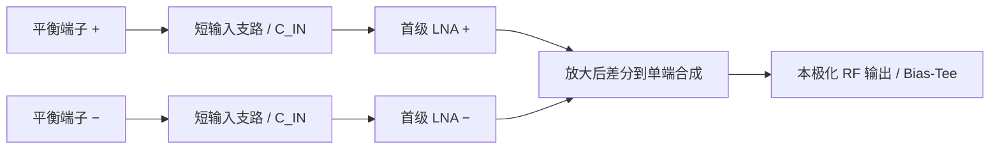

# 项目复盘与 Ver1.0 天线工程定义

日期：2026-10-27

决策性质：用户委托的产品方向决策；**工程方向确定，射频/硬件资格尚未通过**。

复盘基线：`0293524dccb04fb707e533f0fa956b09fb7a80a2`。

当前科学结论：`HOLD_M7C_GUARD`；直接频点诊断：`H_NUM_SUPPORTED_M7C_DIRECT_SAMPLE`。

本文件与 [D0023](DECISIONS.md#d0023--define-ver10-as-a-chartsar0-b-dual-polarized-active-array-element) 一起定义初版交付方向，不是新的几何、器件选型或执行授权。长期路线仍由 `PROJECT_MAINLINE.md` 控制，当前物理执行仍由 `PROJECT_HANDOFF.md` 与 `execution/stage_contract.json` 控制。本次不改需求、不改原验收阈值、不修改 CST/参数/结果。

## 1. 我们决定做什么

**Ver1.0 做一款 CHARTS 启发的 PCB 双线极化有源阵列单元：上面一块平面花瓣/环形加载辐射板，下面两块正交竖板支撑并承载馈点低噪声电路，接到公共背板；每个单元四路近馈点放大，合成独立的 X/Y 两路射频输出。**

产品交付对象是可复制的有源单元及其装配、测试和校准包。用有限阵列验证它是否能放进阵列工作；数字接收后端属于测试条件和系统接口，不在本版天线硬件交付范围内。

| 项目 | Ver1.0 决策 | 冻结边界 |
| --- | --- | --- |
| 频段 | 连续 1.15–1.65 GHz | 沿用任务需求，覆盖带内而不只检查几个 GNSS 中心频点 |
| 极化 | 两路独立线极化，校准后数字合成 RHCP/LHCP | 保留内部 Pol-A/Pol-B 到外部 X/Y 的可追溯映射；不能仅凭板朝向确定极化 |
| 视场 | 核心离天顶 0–60° | 60–75°保留研究项，不作为初版扩展承诺 |
| 辐射体 | 现有四花瓣、平面环形加载的平衡辐射体 | 保留项目自己的拓扑和参数来源，不宣称精确复制文献 |
| 有源布局 | AR0-B：两块正交竖板顶部，各承载一对首级 LNA | 每个极化两条短且对称的输入支路；四颗 LNA/单元 |
| 机械 | 辐射板 + 两块约 1 mm 的正交 PCB 支架 + 公共背板 | 支架同时承载电路；榫槽/焊接接头须可装配且有真实介质和接触面积 |
| 起步尺寸 | 阵列节距 94 mm；辐射板边长约 70.7 mm；离背板约 57.1 mm | 继承的工程起点；最终节距/高度/材料仍须相应关卡验证，不冒充优化结论 |
| 材料 | 标准 PCB/SMT，FR4 成本基线先行 | 材料采购牌号、实际叠层和损耗尚未定型；低损耗板是否必要由损耗/噪声证据决定 |
| 输出 | 首级增益之后做差分到单端合成，X/Y 各一路 RF 同轴 | 放大后可设 50 Ω 输出；天线/LNA 输入不强制 50/100 Ω |
| 供电 | 两路输出分别支持 Bias-Tee，X/Y 可独立上电 | 电压、稳压/保护/去耦及热设计需后续冻结 |
| 参考器件 | QPL9547 先建立可追溯工程基准 | 不是最终生产选型；替代器件必须用同一源阻抗云比较 |

94 mm 是阵列中心间距，不是给每个单元另放一块 94 mm 独立小地板的产品决定。70.7/57.1 mm 来自既有缩放参数，包含图像推导和项目假设的来源限制；本次没有更改它们的来源等级。详见 [R1A1 参数表](../em/cst/R1_CHARTS_LBAND/parameters_r1a1.csv)、[AR0-B0 架构](R1E1A4A_AR0_B0_STALK_TOP_TWIN_MSL_ARCHITECTURE_FREEZE_V01.md) 与 [B1M 机械定义](R1E1A4A_AR0_B1M_FULL_MECHANICAL_STALK_FREEZE_V01.md)。

## 2. 它实际长什么样、信号怎么走

```text
      平面花瓣/环形加载辐射 PCB（约 70.7 mm）
               四个平衡信号端子
                 │       │
          两块正交竖向 PCB，顶部各一对 LNA
          短输入支路、局部地、就近 RF 去耦
                 │       │
          放大后合成、输出与供电滤波
                 │       │
             公共机械背板/反射面
              X RF+DC   Y RF+DC
```

每个极化的信号链：



两条首级支路的噪声和相关性要在网络模型中计算，不能把两个 LNA 的器件噪声系数简单平均，也不能把一条 50 Ω 测试曲线当作整个天线噪声。

按 QPL9547 的 5 V、65 mA 参考工作点，四颗首级芯片的直流功耗预算为 `4 × 5 × 0.065 = 1.30 W/单元`，每个极化约 130 mA。这只是芯片参考偏置预算，不包含稳压、合成/后级及线缆压降，也不是最终产品功耗。相关工作点见 [Qorvo 官方产品页](https://www.qorvo.com/products/p/QPL9547)。若将来 5×5 全部安装同一四芯片前端，仅首级就是约 32.5 W、50 路 RF 输出：必须提前核算供电、散热、校准和装配成本。

## 3. 整个项目已经证明了什么

| 阶段 | 可保留的成果 | 不能扩大成的结论 |
| --- | --- | --- |
| 文献重建与 L 波段缩放 | 建立项目自有的花瓣/环形加载几何和参数来源；形成可确定性构建的被动模型 | 不是获得了原作者全部尺寸，也不是把原频段的低噪声指标搬到了 GNSS |
| 被动辐射体与馈电表示 | 孤立被动模型数值收敛；分开构造不交叉的差分馈电，避免历史交叉端口伪影 | 孤立 S11 或单个极化成立，不代表两路有源单元同时成立 |
| 94 mm 周期阵列 | R1E0C 在已冻结严重失配标准下通过规定扫描状态；周期建模方法可复用 | 不是最终有源阵列 PASS；两种 60° 扫描面的主动阻抗最大相差约 209 Ω，输入匹配不能只看天顶 |
| 支撑与局部有源地 | 支撑不总能视作透明；历史 S1 最大阻抗变化 15.09084 Ω 超过 10 Ω；H0 局部平面地使参考噪声影子最差约 0.568 dB，超过当时 0.40 dB 门槛 | 失败的是具体支撑/地及源条件，不能据此否定整个平面辐射体家族，也不能把“支撑透明”当作唯一可行性标准 |
| 正交 PCB 与 T01 | 榫槽正交支架、真实过孔/焊接和接地传输过渡形成可复用工程基础；T01 后续数值恢复已合格 | 放大后接地传输 coupon 不能直接搬到平衡天线输入；这曾引入地铜、接触和介质冲突 |
| AR0-B / E1 / E2A、E2B | 转向竖板顶部 twin-MSL/twin-LNA；建立封装焊盘、局部地/过孔、端口参考面及两路独立 donor | 单极化装入分别可用，不能替代四个前端同时装入验证；这些主要仍是被动结构 |
| full-E2C / M3–M6 | 四前端同时存在产生强自加载/模态问题；重端接和已做的固定负载扫描未解决；证据指向信号与回流共同构成的模式 | 不是换一个方便的参考阻抗或在后处理里改端口名称就能修复；尚不能指定唯一铜段为根因 |
| M7A / M7B / M7C | 逐个局部假设留下可比较证据；M7C 差模恢复 6/6，通过了其中一个问题 | M7C 对称性 0/10、原 Guard 失败，不能作为 Ver1.0 合格输入拓扑 |
| 直接频点诊断 | 同结构直接计算后，最显眼的单向极弱尖峰不复现，正反向约 −101.2 dB，支持旧宽带表示的数值解释 | 其他 Guard 起伏和宽带支路不对称仍在；这没有洗掉 `HOLD_M7C_GUARD` |

关键证据入口：

- [周期扫描结论](../evidence/r1e0c_closeout_20260924/FINAL_REPORT.md)。
- [决策 D0011–D0016：支撑、Receiver Gate 与 H0 结论](DECISIONS.md)。
- [规范模型谱系与旧分支用途](R1E1A4A_AR0_B1R_R4_A0_E3F_CANONICAL_MODEL_LINEAGE_V01.md)。
- [远端合地诊断的边界](R1E1A4A_AR0_B1R_R3_D2_M1_DUAL_POL_INTERPRETATION_V01.md)。
- [M6 机制分类](../evidence/R1E1A4A_AR0_B1R_R4_A0_E2C_S0_M6_D1D2_MECHANISM_CLASSIFICATION_V01/M6_D1D2_MECHANISM_CLASSIFICATION.md)。
- [M7C 宽带结果](M7C_STORAGE_RECOVERY_SOLVE_RESULT_20261026.md) 与 [直接频点诊断](M7C_DIRECT_SAMPLE_DIAGNOSTIC_RESULT_20261027.md)。

文献依据也要守住范围：[2025 CHARTS 论文](https://www.ieice.org/publications/proceedings/bin/pdf_link.php?fname=1571143655.pdf&iconf=ISAP&lang=E&number=1571143655&vol=98&year=2025) 支持低成本平面辐射体、平衡近馈点放大的设计思路；论文所述当前科学实现采用单极化，双极化为可升级能力。它不是本项目四前端 L 波段共存、噪声或扫描性能已经成立的证据。

## 4. 复盘后的关键判断

**目前的主要矛盾在馈点前端的共同存在与真实回流闭合。辐射体保留，前端地/回流继续做有边界的验证。**

这不等于辐射体已经最终合格。当前证据足以继续这条路线，但还不足以确定完整有源结构的扫描阻抗、有效面积、噪声、稳定性和圆极化性能。

过去有三个值得纠正的工作方式：

1. **子模块成功之后，系统闭合来得偏晚。** 单极化、局部焊盘、传输 coupon 分别成立，组合后仍可能改变辐射体的电流和参考势。后续每个模块都必须有明确的组合验证出口。
2. **诊断模型积累很多，不能把其中某一个当成完整硬件。** E2C S0 的部分矩阵以及当前四块有限独立地，适合回答有限的共存问题；它们缺少完整器件、C_IN/C_OUT、偏置、输出和实际接地路径，不能直接给整机噪声/稳定性下结论。
3. **不能围着极弱曲线的小特征无限修铜。** 直接点已表明一个尖峰具有数值表示问题；真正宽带不对称仍须解释。先冻结可区分假设和停机条件，再做唯一必要的物理实验。

## 5. 地、材料和器件的具体边界

### 地与回流

- 辐射板只有平衡信号连接；不把任一辐射臂当作电路地，不让前端地平面覆盖辐射铜。
- 首级 LNA 的 paddle、地焊盘、过孔和 RF 去耦必须组成短的局部回路；不能要求远处同轴屏蔽层承担唯一的高频回流。
- `G_AP/G_AN/G_BP/G_BN` 是现阶段四个真实有限局部地，不是四个神奇的理想隔离系统。它们怎样连接到正负支路合成、两路供电、同轴外导体、背板和屏蔽，必须逐段画出并建模。
- 不在电路软件里偷偷把四个地短成理想公共地；也不直接恢复已出现强失配的旧下部远端合地方案。确切合地点、铜宽、开槽和屏蔽形状仍须单独验证。
- 原生 thin-PEC-edge 警告位于继承的 tongue/solder 接触处。进入最终损耗/噪声资格之前，要有可制造的有限面积接头及数值资格；目前不能声称它造成了全部不对称。

### 材料与有源器件

- 继续以标准 FR4 结构控制装配成本，但“用 FR4 起步”不等于其带内损耗已经合格。先量化首级前损耗，再决定是否仅对敏感电路区域使用低损耗材料。
- QPL9547 是建立模型、噪声预算和测量流程的参考，不锁成生产唯一器件。精确型号、偏置与成本候选要在同一源条件下比较。
- 当前 D0 中，密集 S 参数外部资产未完成恢复，宽带无源器件模型也不完整；已有稀疏 S 锚点和另源噪声数据不能冒充全频段合格模型。见 [D0 模型权威审查](R1E1A4A_AR0_B1R_R4_A0_D0_DEVICE_COMPONENT_MODEL_AUTHORITY_REVIEW_V01.md)。
- 不加入首级前滤波器或无源巴伦，除非后续实际阻塞/稳定性或系统证据证明必要并重新分配预算。放大后合成网络的损耗、相位和噪声仍须计入。

## 6. Ver1.0 怎样才算做完

方向确定不是硬件发布 PASS。Ver1.0 发布必须留下以下可追溯交付物与验证记录：

| 交付/关卡 | 必要证据 |
| --- | --- |
| 可复制的结构 | 参数化 CAD/CST、PCB/Gerber、BOM、装配图、铜/介质/焊接与接地清单，真实接头、间隙和装配公差 |
| 完整电气闭合 | 四首级、输入/输出元件、去耦、偏置、合成、屏蔽和连接器的模型与实物参考面对应，区分所有信号/回流 |
| 数值和模态资格 | 正式网络完整性/收敛/互易/功率检查，以及适用参考面的模式转换、支路幅相对称性；保留现有失败门槛和历史结果 |
| 阵列源环境 | 真实支架与前端无源几何参与的周期/扫描模型；节距/材料贸易后形成 R1E2 主动阻抗云与嵌入方向图 |
| 噪声与稳定性 | 依据实际源阻抗云，建立相关噪声及带内/带外、差模/共模、源/负载变化和反馈稳定性；器件单体 K/μ 不是整机证明 |
| 有限阵列 | 以 5×5 为首个验证规模，检查中心/边缘/角落；规模是否足够由边界/嵌入响应证据判断，必要时另立 7×7 验证关 |
| 实测与校准 | 供电/温升/增益/噪声/稳定性，双极化复数响应及重复装配/重上电校准；校准后 RHCP/LHCP、轴比和扫描响应 |
| 低成本可生产性 | 实际报价、装配工时/良率、供电与散热预算；不以“普通 PCB”替代成本证据 |

现有噪声预算继续生效：项目接收机参考目标 NF ≤0.5 dB；[Gate R](R1E1A4A_GATE_R_RECEIVER_FREEZE_V01.md) 的既有设计分配为器件/源条件影子 ≤0.40 dB、首级前损耗 ≤0.05 dB、名义接收机 ≤0.45 dB，以及结构增量 ≤+0.05 dB。适用的源状态、参考面与模型资格须在新合同中明确，不能用本次产品决策放松旧门槛，也不能仅凭参考器件手册声称达到。

尚未有权威冻结的完整极化/轴比、绝对灵敏度、量产公差、环境及测量误差预算，须在各自验证**之前**制定，不从已见结果反推合格线。核心扫描面沿用既有计划并扩展到规定的 φ=0/45/90°及历史严重状态；不能只挑表现最好的一条切面。

5×5 是天线有限阵列验证目标，不自动扩张为开发一套 50 通道数字后端。要宣称实测阵列波束、圆极化或 G/T 通过，就必须具备相应的相干采样/校准条件；若只有单元或有限无源测试，只能报告对应范围，不能签发整阵列资格。

## 7. 从现在到初版的收敛路线

保持既有 AR0/E3F 路线次序，并把每一段的出口写清楚：

1. **当前唯一物理前置工作：离线回流假设审查。** 画出四支路从辐射端子、输入焊盘、局部参考地到去耦/输出的连接和耦合图；利用已有完整/单极化/M7 数据比较旋转对应与支路自加载差异。产出一个有证据支持的主假设、必要网络/参考面、唯一待改变变量、预登记通过/停止条件；证据不够则 HOLD，不能直接扫 moat。
2. **同时完成离线模型准备。** 恢复可追溯器件 S/噪声与宽带无源模型，冻结偏置、带外范围和误差边界。这是原 D0 的准备工作，不是开启有源求解。若模型拿不到，明确记为阻塞，不用稀疏插值冒充权威模型。
3. **在单独冻结、授权后完成共存与全网络可行性。** 先回答当前对称性/回流假设，再建立 C1 所需完整被动网络及主动前端初步可行性。仍有适用 gate 未通过时，不能跳到硬件发布。
4. **回到阵列主线。** 在真实集成几何下完成节距/材料贸易和 R1E2 扫描阻抗云，再冻结输入网络并做噪声/稳定性联合设计。既有 94 mm 裸单元结果作为方法与起点，不代替此步骤。
5. **有限阵列、样机与实测闭合。** 先完成有源单元工程样机，再用有限阵列中心/边缘/角落和相干极化校准检查，满足范围后发布 Ver1.0。

不再设“不断做局部小改，总会变好”的开放优化任务。每次执行必须指向上述一个出口；假设被否定就关闭该分支，新的假设另立合同，不在原关卡中换目标。若此架构在完整且可信模型下无法满足核心噪声/扫描/稳定性或可制造性要求，再启动与 PUMA 的同需求、同成本和集成边界比较，按 `PROJECT_RULES.md` 的 replacement test 决定是否换主线。

## 8. 本次方向审查的范围与检查

- 审查输入是已提交的项目需求、主线、决策、模型谱系及关卡报告；未获得新的电磁、器件或硬件测量证据。
- 更新产品方向、决策和文档入口；不更改原需求、工程参数、物理模型、评估器和保护结果。
- 没有启动 CST 应用、BUILD 或 SOLVE。当前物理执行仍停在离线假设审查，所有 live grants 关闭。
- `execution/stage_contract.json` 保持原字节；审查前 SHA256 为 `fbd16d2a25fd6fff304c8c6174bb0b45c0df72a79e10b03ad1c8ff3e2e1526f1`，其已关闭的执行身份继续有效。

结论：**继续 CHARTS/AR0-B，做出可复制、可测的双极化有源单元；以完整回流、阵列源环境和真实接收机验证收敛，当前 M7C 不提升为合格产品。**
